# Worker Payroll · رواتب العمال

[English](#english) · [العربية](#arabic)

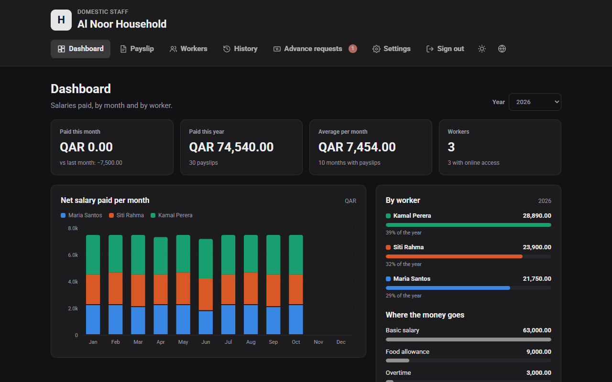

---

<a id="english"></a>

## English

### What it is

Worker Payroll is a small web app you run on your own server (for example a home server with Docker). It is made for families who employ domestic staff: housemaids, nannies, drivers.

- The **employer** adds workers, fills in each month's pay, and prints or downloads a clean A4 **PDF payslip** in English.
- Each **worker** signs in with their ID card number to see their own payslips and salary chart, and can **request a salary advance**.
- The interface works in **Arabic and English**, with a **day and night** theme.

### Demo accounts

Run the demo script (see *Try it with demo data*) to get example data. These names and numbers are made up.

| Role | Sign in with | Password |
|---|---|---|
| Employer (admin) | `admin` | `admin1234` |
| Worker: Maria Santos, Housemaid | `28460000001` | `worker1234` |
| Worker: Siti Rahma, Nanny | `28460000002` | `worker1234` |
| Worker: Kamal Perera, Driver | `28460000003` | `worker1234` |

The demo household is **Al Noor Household**, Doha, Qatar, paying in QAR.

Change these passwords before you use the app with real people.

### Screens

| | |
|---|---|
| **Sign in.** One form for everyone: the employer types a username, a worker types an ID card number. The app opens the right page. 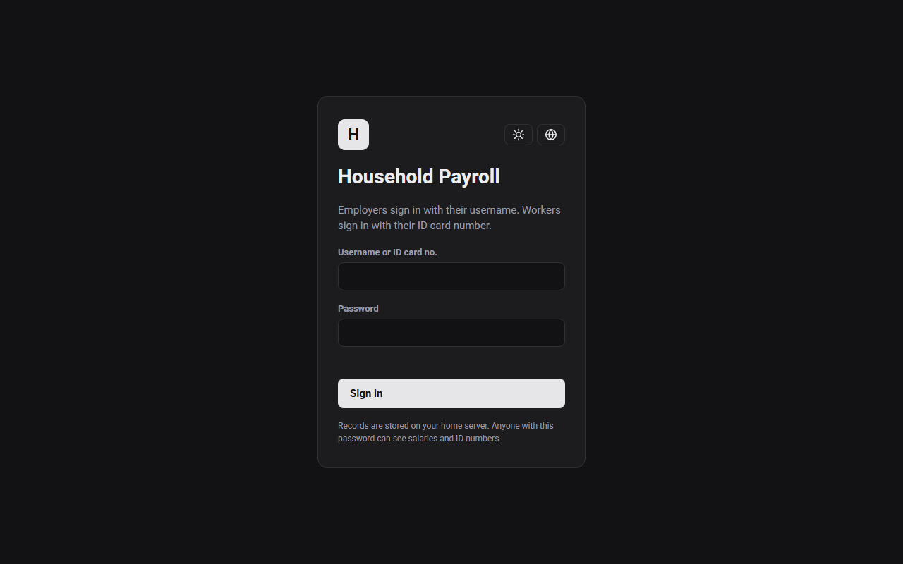 | **Dashboard.** Totals for this month and year, a monthly bar chart split by worker, each worker's share, and where the money goes.  |
| **New payslip.** Pick a worker and month, enter earnings and deductions. The summary shows net pay in numbers and words. 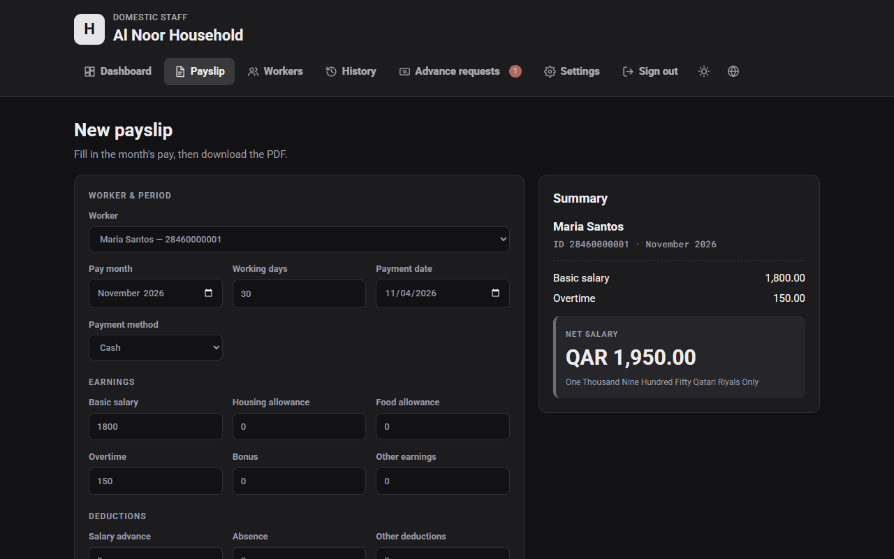 | **Workers.** Name, ID card number, nationality, job and basic salary. "Online" marks workers who can sign in. 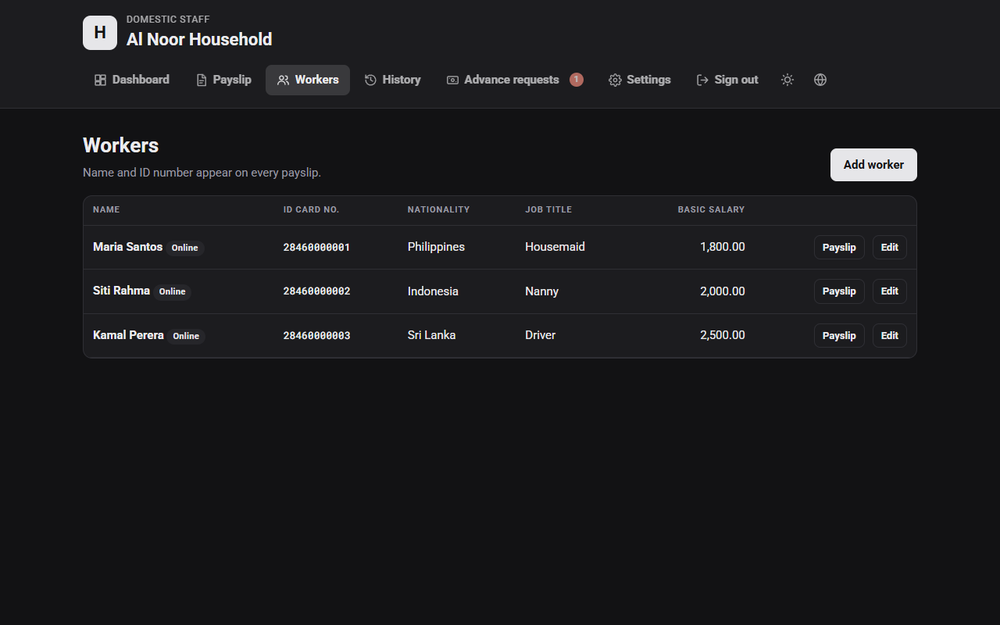 |
| **Edit worker.** Personal details, plus the worker's own password for online payslips. 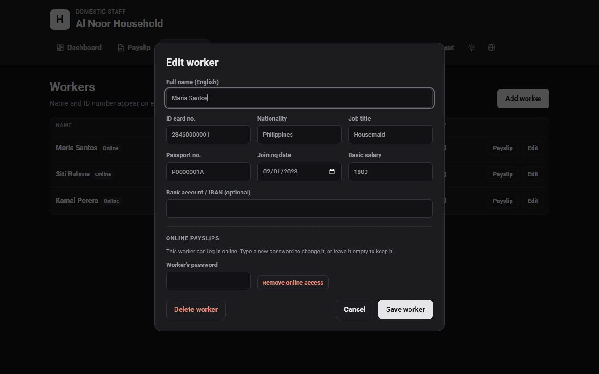 | **History.** Every saved payslip, ready to print or download again. 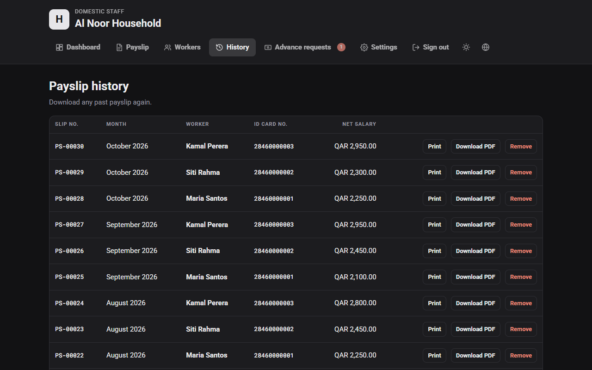 |
| **Advance requests.** Approve or reject with an optional note. A red badge counts new requests. 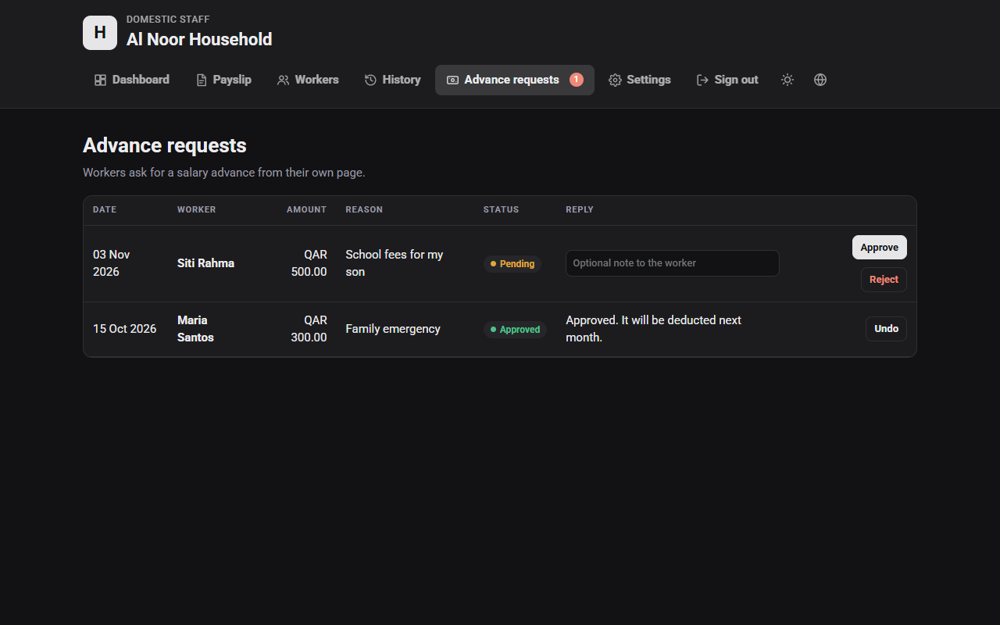 | **Settings.** Employer details, country and currency, backup and restore, and the employer login. 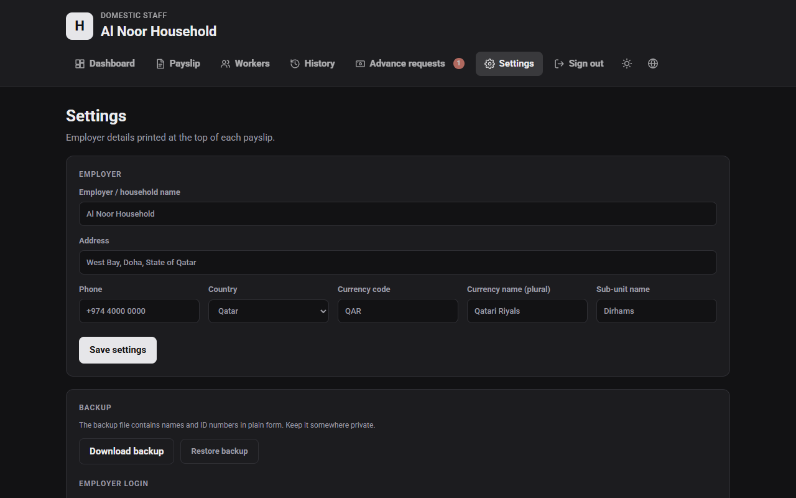 |
| **Arabic, day theme.** The whole interface switches to Arabic, right to left. 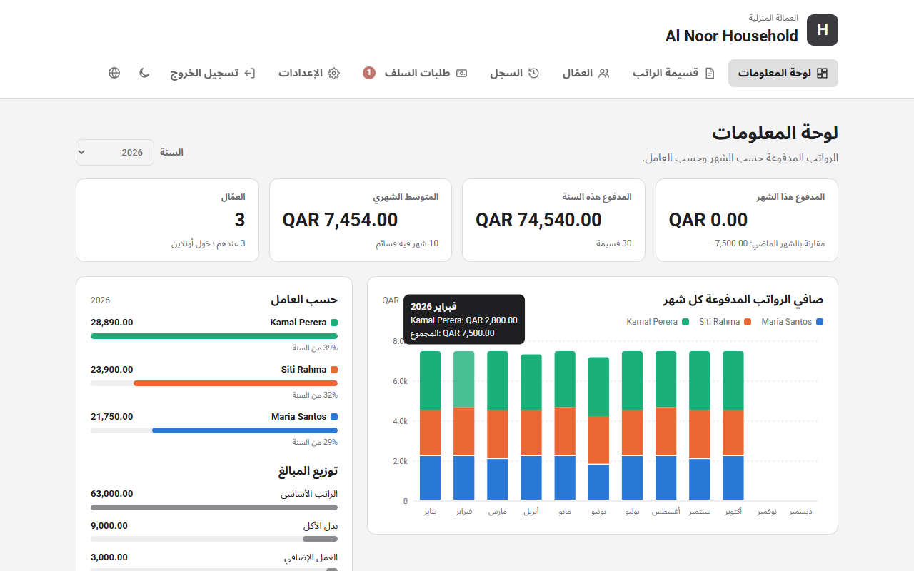 | **Worker page.** The worker's salary chart, advance request form, replies, and payslips. 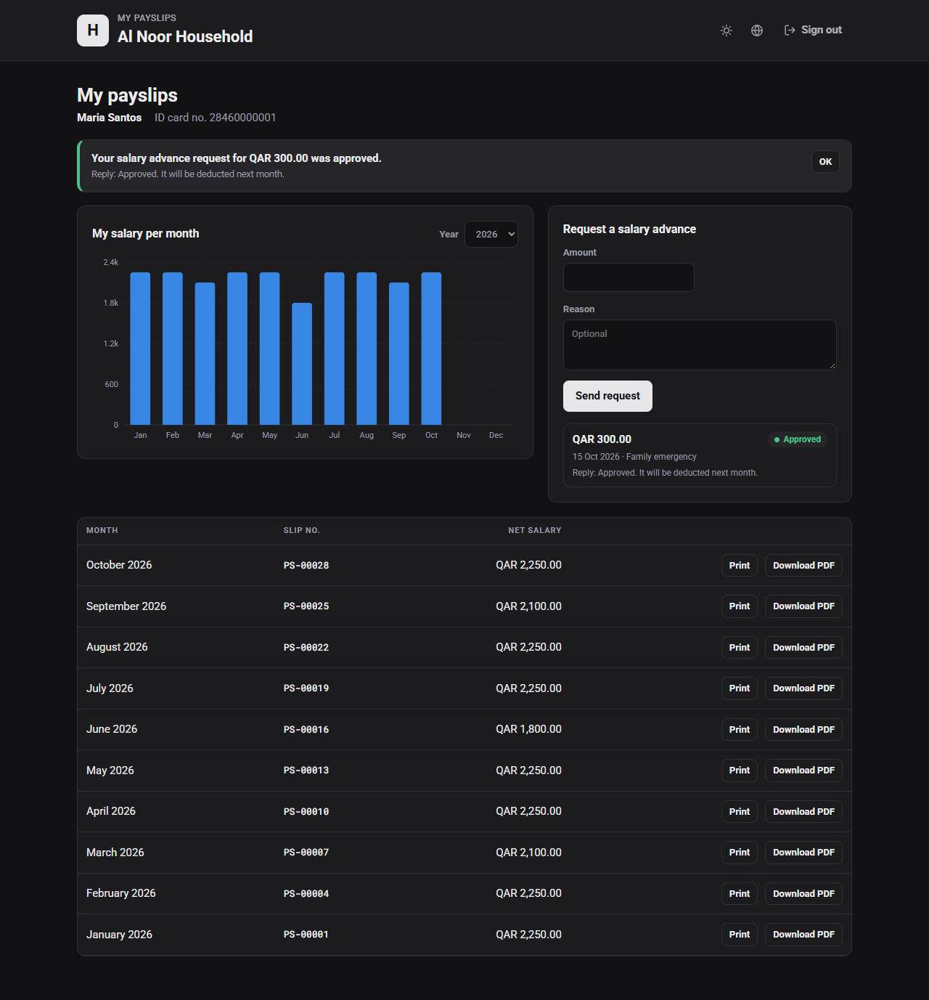 |
| **Worker page in Arabic.** 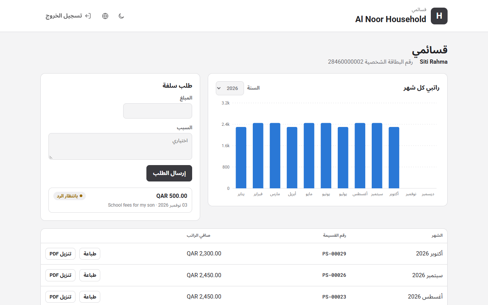 | **The PDF payslip.** A4, English, with signatures and net pay in words. 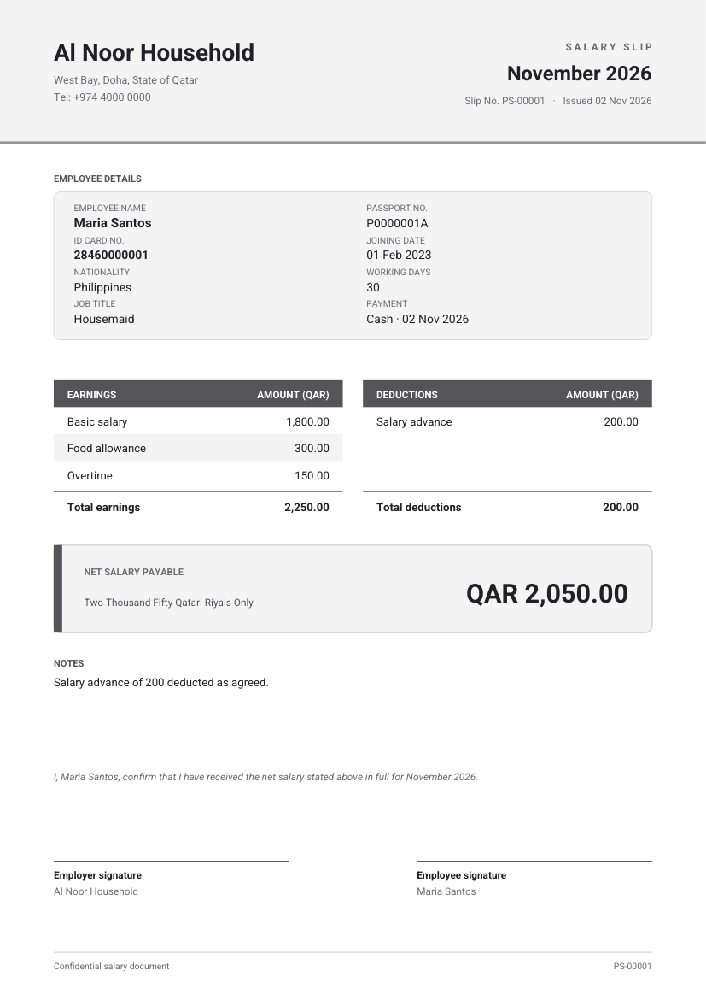 |

### What the project is made of

```
household-payroll/
├── index.html            The whole interface: pages, styles, translations, charts, PDF drawing
├── server.js             Node.js server: sign-in, sessions, saving data, worker and advance APIs
├── fonts/                Roboto TTF files, embedded in every PDF
├── scripts/seed-demo.js  Creates the demo data and accounts above
├── Dockerfile            Builds the app image (Node 20, Alpine)
├── docker-compose.yml    Runs it on port 8097 with ./data kept on the host
├── package.json          One dependency: jsPDF (draws the payslip PDF)
└── docs/screenshots/     The images in this file
```

**How the parts work together**

1. **Browser (`index.html`).** A single page with no build step. It talks to the server with `fetch`, draws the charts as SVG, and creates the PDF in the browser with jsPDF and the Roboto font.
2. **Server (`server.js`).** Plain Node.js with no framework. It serves the page, checks passwords, gives each signed-in person a session cookie, and decides what they may see. A worker can only ever read their own payslips.
3. **Data (`./data` on the host).** Simple JSON files:

| File | Holds |
|---|---|
| `payroll.json` | Settings, workers and payslips |
| `auth.json` | Employer username and password hash |
| `worker-auth.json` | Each worker's password hash |
| `advance-requests.json` | Advance requests and replies |

Passwords are stored as **scrypt** hashes, never as plain text. Repeated wrong passwords lock that address out for a minute.

### Run it with Docker

```bash
docker compose up -d --build
```

Open `http://<your-server>:8097`. On the first visit you choose the employer username and password.

### Try it with demo data

```bash
npm install
node scripts/seed-demo.js demo-data
```

Then start the server against that folder: `DATA_DIR=demo-data node server.js` on macOS or Linux, or `$env:DATA_DIR="demo-data"; node server.js` in PowerShell. Open `http://localhost:8080` and sign in with a demo account.

### Keep it safe

- `data/` holds real names, ID numbers and salaries. It is in `.gitignore`; never commit it. Back it up.
- Use the app on your home network only, or put it behind HTTPS (a reverse proxy) before you open it to the internet.

### License

The Roboto fonts in `fonts/` are under the Apache License 2.0.

---

<a id="arabic"></a>

<div dir="rtl">

## العربية

### وش هو المشروع

**رواتب العمال** موقع صغير تشغّله على سيرفرك الخاص، مثل سيرفر البيت بدوكر. مصمّم للعوائل اللي عندها عمالة منزلية: عاملات منزل، مربيات، سوّاقين.

- **صاحب العمل** يضيف العمال، ويعبّي راتب كل شهر، ويطبع أو ينزّل **قسيمة راتب PDF** مرتبة بمقاس A4 وبالإنجليزي.
- **العامل** يدخل برقم بطاقته الشخصية ويشوف قسائمه ورسم بياني لراتبه، ويقدر **يطلب سلفة**.
- الواجهة **بالعربي والإنجليزي**، وفيها **وضع نهاري وليلي**.

### الحسابات التجريبية

شغّل سكربت البيانات التجريبية (شوف قسم *التجربة ببيانات تجريبية*). كل الأسماء والأرقام هنا وهمية.

| الدور | الدخول بـ | كلمة السر |
|---|---|---|
| صاحب العمل (المدير) | `admin` | `admin1234` |
| العاملة: ماريا سانتوس، عاملة منزل | `28460000001` | `worker1234` |
| العاملة: سيتي رحمة، مربية | `28460000002` | `worker1234` |
| العامل: كمال بيريرا، سائق | `28460000003` | `worker1234` |

المنزل التجريبي اسمه **Al Noor Household** في الدوحة، قطر، والعملة ريال قطري.

غيّر كلمات السر هذي قبل ما تستخدم الموقع مع أشخاص حقيقيين.

### الصفحات

1. **تسجيل الدخول.** خانة وحدة للكل: صاحب العمل يكتب اسم المستخدم، والعامل يكتب رقم بطاقته، والموقع يفتح الصفحة المناسبة.
2. **لوحة المعلومات.** مجموع الشهر والسنة، ورسم بياني شهري لكل عامل بلون، ونصيب كل عامل، وتوزيع المبالغ.
3. **قسيمة الراتب.** تختار العامل والشهر، وتكتب الاستحقاقات والخصومات، ويطلع لك الصافي بالأرقام والكلمات.
4. **العمال.** الاسم ورقم البطاقة والجنسية والمهنة والراتب الأساسي. كلمة "أونلاين" تعني إن العامل يقدر يدخل.
5. **تعديل العامل.** البيانات الشخصية، وكلمة سر العامل عشان يشوف قسائمه أونلاين.
6. **السجل.** كل القسائم المحفوظة، تطبعها أو تنزّلها من جديد.
7. **طلبات السلف.** موافقة أو رفض مع ملاحظة اختيارية، ورقم أحمر يبيّن عدد الطلبات الجديدة.
8. **الإعدادات.** بيانات صاحب العمل، والدولة والعملة، والنسخة الاحتياطية، وبيانات دخول صاحب العمل.
9. **صفحة العامل.** رسم بياني لراتبه، وطلب سلفة، والردود، وقسائمه.
10. **قسيمة PDF.** بالإنجليزي وبمقاس A4، فيها التواقيع والصافي مكتوب بالكلمات.

الصور موجودة فوق في القسم الإنجليزي، وفي مجلد `docs/screenshots`.

| لوحة المعلومات بالعربي | صفحة العامل بالعربي |
|---|---|
|  |  |

### مما يتكوّن المشروع

| الملف | وظيفته |
|---|---|
| `index.html` | الواجهة كاملة: الصفحات والتصميم والترجمة والرسوم البيانية ورسم القسيمة |
| `server.js` | سيرفر Node.js: تسجيل الدخول والجلسات وحفظ البيانات وخدمات العمال والسلف |
| `fonts/` | خط Roboto اللي ينحط داخل كل ملف PDF |
| `scripts/seed-demo.js` | ينشئ البيانات والحسابات التجريبية |
| `Dockerfile` | يبني صورة الموقع (Node 20) |
| `docker-compose.yml` | يشغّل الموقع على المنفذ 8097 ويحفظ البيانات في مجلد `data` |
| `package.json` | مكتبة وحدة بس: jsPDF لرسم القسيمة |

**كيف تشتغل الأجزاء مع بعض**

1. **المتصفح (`index.html`):** صفحة وحدة، تكلّم السيرفر، وترسم الرسوم البيانية، وتسوي ملف الـ PDF داخل المتصفح.
2. **السيرفر (`server.js`):** يتحقق من كلمات السر، ويعطي كل شخص جلسة دخول، ويحدد وش يقدر يشوف. العامل ما يقدر يشوف إلا قسائمه هو.
3. **البيانات (مجلد `data`):** ملفات JSON بسيطة:

| الملف | فيه |
|---|---|
| `payroll.json` | الإعدادات والعمال والقسائم |
| `auth.json` | اسم مستخدم صاحب العمل وكلمة السر مشفّرة |
| `worker-auth.json` | كلمات سر العمال مشفّرة |
| `advance-requests.json` | طلبات السلف والردود |

كلمات السر محفوظة مشفّرة بطريقة **scrypt**، وما تنحفظ كنص عادي أبداً. وإذا انكتبت كلمة سر غلط أكثر من مرة، ينقفل الدخول من نفس الجهاز لمدة دقيقة.

### التشغيل بدوكر

</div>

```bash
docker compose up -d --build
```

<div dir="rtl">

افتح `http://<سيرفرك>:8097`. أول مرة يطلب منك تختار اسم مستخدم وكلمة سر لصاحب العمل.

### التجربة ببيانات تجريبية

</div>

```bash
npm install
node scripts/seed-demo.js demo-data
```

<div dir="rtl">

بعدها شغّل السيرفر على المجلد هذا، وادخل بأحد الحسابات التجريبية على `http://localhost:8080`.

### الحماية

- مجلد `data` فيه أسماء وأرقام بطاقات ورواتب حقيقية. موجود في `.gitignore`، فلا ترفعه أبداً، وخذ منه نسخة احتياطية.
- استخدم الموقع على شبكة البيت بس، أو حطه خلف HTTPS قبل ما تفتحه على الإنترنت.

</div>
